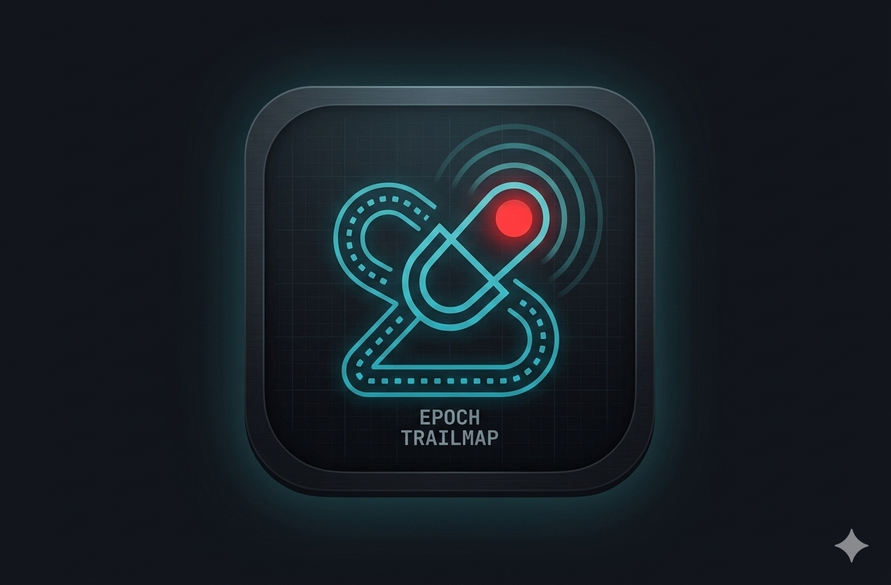

# Epoch Trail 🎯

> **Zero-Overhead Tactical Rolling Buffer, Audio DSP Engine, and Frame-by-Frame Video Telestrator for Competitive Gamers, Esports Teams, and Coaches.**



---

## 📖 Table of Contents
- [Overview & Philosophy](#-overview--philosophy)
- [Key Features](#-key-features)
- [Architectural Highlights & Why We Built This](#-architectural-highlights--why-we-built-this)
  - [1. Zero-Disk-Wear Circular RAM Buffer](#1-zero-disk-wear-circular-ram-buffer)
  - [2. HTTP 206 Partial Content Video Streaming (`epoch-media://`)](#2-http-206-partial-content-video-streaming-epoch-media)
  - [3. Zero-RAM Disk Cached Thumbnails (`.epoch_thumbnails/`)](#3-zero-ram-disk-cached-thumbnails-epoch_thumbnails)
  - [4. Multi-Stage Microphone Anti-Static DSP & Noise Gate](#4-multi-stage-microphone-anti-static-dsp--noise-gate)
  - [5. High-Resolution Audio Bitrate & 96kHz DAC Support](#5-high-resolution-audio-bitrate--96khz-dac-support)
  - [6. In-App Fullscreen Theater & Vector Telestrator](#6-in-app-fullscreen-theater--vector-telestrator)
  - [7. Input-Blocking In-App Video Trimming](#7-input-blocking-in-app-video-trimming)
  - [8. Close-to-Tray Background Execution & Toast Redirection](#8-close-to-tray-background-execution--toast-redirection)
- [Configurable Keyboard Shortcuts](#-configurable-keyboard-shortcuts)
- [Developer Notes & Setup](#-developer-notes--setup)

---

## ⚡ Overview & Philosophy

Traditional clipping utilities (like OBS Replay Buffer or Shadowplay) either consume high background CPU/GPU resources or constantly churn gigabytes of temporary video files directly onto SSDs, degrading flash cells and introducing micro-stutters during intense gunfights.

**Epoch Trail** is engineered from the ground up to solve these problems:
1. **Zero SSD Wear**: Keeps rolling video keyframes in a circular RAM buffer.
2. **Instant Tactical Telestrator**: Freeze the last 15s–10m instantly with global hotkeys (<kbd>Alt+Shift+T</kbd>) to draw arrows, halos, and notes directly on the frame.
3. **Pristine Studio Audio**: Dual-track mixing with high-bitrate AAC (up to 384 kbps), 96kHz soundcard support, multi-stage 80Hz rumble cut, and an adaptive silence noise gate to completely eliminate mic static.

---

## 🚀 Key Features

- **🎮 Background Circular Buffer**: Records high-fps desktop/gameplay in RAM with configurable buffer duration (15s, 30s, 60s, 2m, 5m, 10m).
- **🎨 Vector Tactical Telestrator**: Draw freehand brush strokes, directional movement arrows, focus halos, zone boxes, and text notes.
- **🕒 Strict Frame Anchoring**: Annotations are anchored to specific timestamps (`±0.5s`), keeping playback clear and uncluttered.
- **✂️ Lossless Video Trimming**: Set In/Out brackets on the timeline and export trimmed sub-clips directly to your Vault folder with zero quality loss.
- **🎙️ Dual Audio Mixer**: Captures uncompressed system/game sound alongside hardware microphone inputs.
- **🔇 Multi-Stage Anti-Static & Noise Gate DSP**: Eliminates 50/60Hz AC electrical hum, USB preamp static, and fan noise with real-time dB visual meters.
- **🎛️ High-Fidelity Audio Bitrate**: 128 kbps to 384 kbps studio encoding with 44.1kHz, 48kHz, and 96kHz hardware support.
- **🖼️ Vault Gallery & Zero-RAM Thumbnails**: Manage, search, rename, and export clips without exhausting GPU decoder contexts.
- **🖥️ In-App Fullscreen Theater Mode**: Press <kbd>F</kbd> to expand the video player edge-to-edge for distraction-free VOD reviews.
- **📌 Close-to-Tray & Toast Notifications**: Runs seamlessly in the background and redirects straight to review when a notification is clicked.

---

## 🧠 Architectural Highlights & Why We Built This

### 1. Zero-Disk-Wear Circular RAM Buffer
- **The Problem**: Writing continuous 1080p60/4K video to an SSD creates hundreds of gigabytes of disk writes daily, accelerating drive failure and causing game micro-stutters.
- **The Solution**: Uses WebCodecs hardware H.264 `VideoEncoder` directly in browser memory. Expired frames outside the sliding time window are discarded in a FIFO ring buffer. Disk I/O occurs **only** when the player explicitly clips.

### 2. HTTP 206 Partial Content Video Streaming (`epoch-media://`)
- **The Problem**: Loading raw 500MB+ `.mp4` files via standard `file://` or blob URLs requires loading the entire file into RAM, which crashes Chromium with `RESULT_CODE_KILLED_BAD_MESSAGE` or `Error Code 5` OOM.
- **The Solution**: Electron's `protocol.handle('epoch-media')` implements true HTTP 206 Range request streaming via Node `fs.createReadStream(path, { start, end })`. Chromium only reads the exact video chunk being played, cutting memory usage from 2GB+ down to < 50MB and enabling instant scrubbing.

### 3. Zero-RAM Disk Cached Thumbnails (`.epoch_thumbnails/`)
- **The Problem**: Spawning multiple `<video>` HTML elements in a gallery creates multiple GPU hardware decoder sessions, rapidly exceeding Windows OS limits and exhausting memory.
- **The Solution**: A dedicated `.epoch_thumbnails/` disk cache stores lightweight companion `.jpg` images generated at save time. The gallery loads pure static images, guaranteeing 60fps UI performance even with hundreds of saved clips.

### 4. Multi-Stage Microphone Anti-Static DSP & Noise Gate
- **The Problem**: Cheap USB headsets, motherboard 3.5mm jacks, and open microphones pick up constant electrical static hiss, 50Hz/60Hz AC hum, and case fan vibrations during silent moments.
- **The Solution**:
  - **85Hz 2nd-Order High-Pass Filter**: Cuts ground loops and mechanical desk rumbles.
  - **13.5kHz High-Shelf Notch**: Tames USB preamp coil whine and high-frequency white noise.
  - **Adaptive Noise Gate**: Envelope follower measures input RMS. When silent, it smoothly attenuates the microphone to **absolute zero silence** (-inf dB), eliminating all background static.
  - **Visual dB Meter**: Real-time dB readout with an amber threshold line and Gate Open/Closed status indicator.

### 5. High-Resolution Audio Bitrate & 96kHz DAC Support
- **The Problem**: Standard WebCodecs encoders default to low bitrates (96–128 kbps), and browser speech filters compress sound, muffling high-end gaming soundcards running at 96,000 Hz.
- **The Solution**: Full bitrate selection (128k, 192k, 256k, 320k, 384k) and sample rate mapping (44.1k, 48k, 96k). Includes a "Bypass Speech DSP" mode that delivers uncompressed, transparent studio fidelity.

### 6. In-App Fullscreen Theater & Vector Telestrator
- **The Problem**: Tactical analysis requires maximum screen real estate without distracting sidebars.
- **The Solution**: Pressing <kbd>F</kbd> hides the sidebar and expands the video canvas to 100% of the viewport while keeping the top annotation bar and bottom scrubber accessible.

### 7. Input-Blocking In-App Video Trimming
- **The Problem**: Accidental clicks or navigation while exporting a trimmed clip can corrupt MP4 muxer buffers.
- **The Solution**: A full-screen `createPortal` modal with `z-[999999]` locks all user input with live progress percentage indicators until the file is written to the Vault.

### 8. Close-to-Tray Background Execution & Toast Redirection
- **The Problem**: Closing the app shouldn't stop background clipping, and clicking a Windows clip toast should instantly navigate to that clip.
- **The Solution**: The titlebar <kbd>X</kbd> button calls `mainWindow.hide()` into the system tray. Toast clicks trigger `onNotificationClipClicked`, un-minimizing the app and opening the clip in Tactical Review.

---

## 🎮 Configurable Keyboard Shortcuts

| Default Shortcut | Action | Scope |
| :--- | :--- | :--- |
| <kbd>Alt + Shift + T</kbd> | Save Clip to Vault & Open Tactical Review | Global (In-Game & App) |
| <kbd>F9</kbd> | Start / Stop Background Rolling Buffer | Global (In-Game & App) |
| <kbd>F</kbd> | Toggle In-App Fullscreen Theater Mode | Tactical Review |
| <kbd>Escape</kbd> | Exit Fullscreen / Dismiss Window to Tray | App |
| <kbd>Space</kbd> | Play / Pause Video Playback | Tactical Review |
| <kbd>←</kbd> or <kbd>J</kbd> | Step Backward 1 Frame (~16.6ms) | Tactical Review |
| <kbd>→</kbd> or <kbd>L</kbd> | Step Forward 1 Frame (~16.6ms) | Tactical Review |
| <kbd>I</kbd> / <kbd>O</kbd> | Set Trim In-Point / Out-Point | Tactical Review |
| <kbd>Ctrl + Z</kbd> | Undo Last Annotation Stroke | Tactical Review |
| <kbd>Delete</kbd> | Clear All Annotations on Frame | Tactical Review |
| <kbd>D</kbd> | Toggle Drawing Canvas Mode | Tactical Review |

*All keybinds are fully customizable in Settings (⚙️) ➔ Custom Keybinds.*

---

## 🚀 Developer Notes & Setup

### Requirements
- **Node.js**: `v18.x` or `v20.x`+
- **Platform**: Windows 10/11 (or Linux/WSL2 with Electron build tools)

### Installation
```bash
# Clone the repository
git clone <repository-url>
cd epoch-trailmap

# Install dependencies
npm install
```

### Development Scripts
```bash
# Start Vite React Web HUD
npm run dev

# Start Electron application in development mode
npm run electron:dev

# Type-check TypeScript & build frontend + Electron main
npm run build:all
```

### Packaging Windows Executable
```bash
# Build unpackaged Windows binaries (fast iteration)
npm run dist:win:dir

# Output folder:
release/win-unpacked/Epoch Trail.exe
```

---

## 📄 License
MIT © **Epoch Trail Team**
