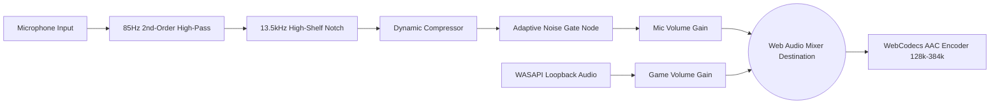

# Epoch Trail — Audio DSP & Noise Filtering Guide

This document details the multi-stage audio processing pipeline in Epoch Trail, explaining why static noises occur, how the filters work, and how to configure optimal sound settings.

---

## 1. The Problem: PC Audio Noise Floors & Static

PC gaming environments face several distinct audio interference issues:

1. **Mains & Ground Loop Hum (50Hz / 60Hz)**:
   - Caused by AC power supplies, ground loops between PC and audio interface, or GPU coil vibrations transmitted through the motherboard.
2. **Preamp Static / White Noise Floor**:
   - Cheap 3.5mm motherboard jacks and unshielded USB dongles create persistent electrical hiss across high frequencies.
3. **Open Microphone Room Bleed**:
   - When the player is not speaking, open microphones record case fans, air conditioning units, and room reverberation.
4. **Chromium WebRTC Filter Muffling**:
   - Standard WebRTC speech algorithms apply aggressive 11.5 kHz low-pass filtering and Auto-Gain Control (AGC), which crushes sound dynamics and distorts high-end 96 kHz gaming soundcards.

---

## 2. Multi-Stage Audio Pipeline Architecture

---

## 3. Detailed DSP Stages

### Stage 1: 85Hz High-Pass Rumble Filter
- **Type**: Biquad Filter (`type: 'highpass'`, `frequency: 85 Hz`, `Q: 0.707`).
- **Purpose**: Steep 12dB/octave attenuation of sub-bass frequencies. Eliminates 50/60Hz AC electrical hum, desk thumps, and low mechanical fan rumble without thinning human vocal warmth (which begins ~100–120Hz).

### Stage 2: 13.5kHz Anti-Hiss High-Shelf
- **Type**: Biquad Filter (`type: 'highshelf'`, `frequency: 13500 Hz`, `gain: -3.5 dB`).
- **Purpose**: Gently rolls off harsh USB preamp hiss, coil whine, and thermal noise above the primary vocal sibilance range.

### Stage 3: Dynamics Compressor
- **Settings**: `threshold: -22 dB`, `knee: 10 dB`, `ratio: 3:1`, `attack: 4ms`, `release: 120ms`.
- **Purpose**: Transparently controls sudden vocal spikes (shouting during clutches) while keeping quiet callouts intelligible.

### Stage 4: Adaptive Noise Gate
- **Envelope Follower**: Real-time RMS calculation on incoming time-domain data:
  $$\text{dB} = 20 \cdot \log_{10}(\text{RMS})$$
- **State Machine**:
  - **Attack (15ms)**: When $\text{dB} \ge \text{Threshold}$ (default `-42 dB`), the gate smoothly ramps gain to `1.0` (open).
  - **Hold (100ms)**: Keeps the gate open briefly after speech drops below the threshold to prevent clipping the ends of words.
  - **Decay (35ms)**: Smoothly attenuates gain to `0.0` (closed).
- **Result**: **100% absolute silence with zero static hiss when not speaking.**

---

## 4. Audio Quality Configuration Options

Located in **Settings (⚙️) ➔ Audio Configuration**:

| Setting | Default | Range / Options | Description |
| :--- | :--- | :--- | :--- |
| **Audio Bitrate** | `256 kbps` | 128k, 192k, 256k, 320k, 384k | WebCodecs AAC/Opus encoding bitrate for the exported and rolling audio stream. |
| **Sample Rate** | `48.0 kHz` | 44.1 kHz, 48.0 kHz, 96.0 kHz | Matches your Windows sound card hardware sample rate to eliminate resampling distortion. |
| **Bypass Voice DSP** | `OFF` | ON / OFF | When enabled, delivers 100% uncompressed raw studio audio without WebRTC speech filtering. |
| **Anti-Static Filter** | `ON` | ON / OFF | Activates the 85Hz rumble cut and 13.5kHz anti-hiss shaping. |
| **AI Noise Cancellation** | `ON` | ON / OFF | WebRTC spectral noise suppression for room fans and typing. |
| **Adaptive Noise Gate** | `ON` | ON / OFF (`-60` to `-20` dB) | Mutes background noise when silent. Live visual meter displays gate status and threshold position. |
